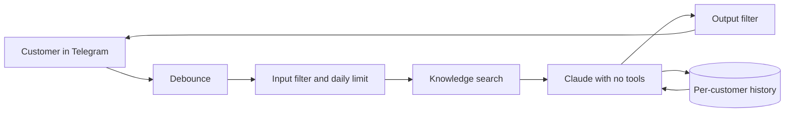

# AI Customer Assistant

A Telegram assistant that answers customers around the clock from a business's own knowledge base, remembers the conversation, and can send one polite follow-up to people who went quiet.

This repository is a clean rewrite of a system I built for a client, with a stronger security design.

> **Status: portfolio example.** The code is covered by offline tests, but this rewrite has not been run against live Telegram and Claude services. Production prompts and client data are not included, and the business in `examples/` is fictional.

**Built with:** Python, Telegram Bot API, Claude Code, SQLite, pytest

## Result from the original system

The client needed fewer moderators in their business chat, which cut support costs.

## How it works



## Engineering decisions

| Decision | Why |
|---|---|
| The model has no tools | Customer text is untrusted. With no shell or file access, a prompt injection has little to act on |
| Filters are a second layer only | Pattern lists can always be bypassed, so they reduce noise and accidental leaks but are not the security boundary |
| Every query is scoped to one customer | One customer's conversation never reaches another's prompt |
| Facts come only from the knowledge base | Prices and policies must not be invented. Missing information is stated as missing |
| It says it is an AI when asked | Customers should know who they are talking to |
| Messages are debounced for 3 seconds | Several quick messages become one request, which saves cost and reads better |
| Old messages become a summary | The model keeps context without sending the whole history every time |
| Daily limit per customer | One person cannot use up the whole budget |
| Follow-ups are off by default | When enabled: daytime only, at most once, never after a purchase, and `/stop` opts out. Check your local marketing rules before turning this on |
| Network errors hide the request URL | The bot token is part of that URL, so it must never reach the logs |

## Project structure

```text
src/customer_assistant/
  bot.py         Telegram client, debouncing and concurrency
  assistant.py   one customer turn, summaries and follow-ups
  agent.py       prompt building and the restricted model call
  knowledge.py   knowledge base search
  guard.py       input and output filters
  store.py       SQLite storage
tests/           offline tests with fake Telegram and model services
examples/        fictional knowledge base and generic prompts
```

## Running it

These are the intended setup steps. They have not been tested end to end on this rewrite. You need Python 3.10+, the [Claude Code CLI](https://claude.com/claude-code) and a bot token from @BotFather.

```bash
python -m venv .venv && source .venv/bin/activate
pip install -e ".[dev]"
cp .env.example .env              # add your token
mkdir -p private
cp -R examples/prompts private/prompts
cp examples/knowledge.md private/knowledge.md
python -m customer_assistant
```

## Tests

```bash
pytest
```

The tests run offline and cover customer isolation, knowledge selection, filters, limits, summaries, follow-up rules, debouncing and token handling.

## What is not included

Voice messages, photo understanding, dashboards and answering from a personal Telegram account are not part of this rewrite. Knowledge search is keyword-based, which is enough for a small FAQ but weaker than semantic search.

## How I used AI

I built this with Claude Code as my development tool. I owned the requirements, architecture, review and deployment decisions.
